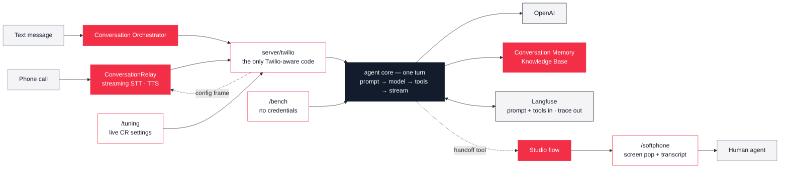

<div align="center">


**One AI agent, reachable by voice, SMS and a browser — with versioned prompts,
versioned tool selection, and every turn traced.**

[](https://nodejs.org)
[](https://nodejs.org/api/typescript.html)
[](https://www.twilio.com/docs)
[](https://langfuse.com)
[](ARCHITECTURE.md#proof-not-claims)

[What it shows](#what-it-shows) · [Capabilities](#capabilities) · [Tools](#tools) ·
[Tuning](#tuning-conversationrelay-live) · [How it fits together](#how-it-fits-together) · [Architecture](ARCHITECTURE.md) ·
[Deploy](DEPLOY.md) · [Deep record](docs/HANDOFF.md)

</div>

---

A clonable starting point for customer-facing Twilio demos. The agent answers a phone call, answers a
text, remembers the caller between conversations, searches a knowledge base, and hands the call to a
human when asked — all from one channel-agnostic core.

The interesting part is not that it works. It is **what is wired up around it**: the things mature implementations have and proofs-of-concept never do.

> [!IMPORTANT]
> **This is a demo scaffold, not a production service.** It is built for the "art of the possible"
> conversation. It degrades loudly rather than failing safely, several endpoints are unauthenticated,
> and it assumes one process holds conversation state in memory. Those are choices —
> [`docs/HANDOFF.md`](docs/HANDOFF.md) names each one under "Gaps and honest limits".

## What it shows

**1. Telemetry you can argue with**

- Every conversation is one Langfuse **session**, keyed by the conversation id, with the caller's memory profile as the user — never a phone number.
- A voice call is one trace. It is **tiled** — `turn.voice` and `caller.turn` alternate with 0 ms of gap, so the root span is fully accounted for. A no-tool turn is four observations; the rest of what used to be spans is metadata on the turn.
- About two minutes after hangup, **Twilio's side of the call is backfilled** from Voice Insights: STT, TTS, agent and caller speech, interrupts, at Twilio's own timestamps.
- "Is it us or the model?" is one attribute, not an investigation.

**2. Prompts that ship without a deploy**

- Prompt, model and tool list live in Langfuse, versioned together.
- Changing behaviour is a revision labelled `production` — live in ~20 s, no redeploy.
- Langfuse down? Compiled-in defaults take over and report their version as `fallback`, so a degraded demo is visible rather than silently different.

**3. Tool selection as data**

- Which tools the agent has, and how each is *described*, is versioned with the prompt.
- A three-way resolver reconciles the prompt's list against a compiled-in catalog and the live credentials.
- Descriptions are load-bearing: one long one is the difference between the knowledge base being used and being ignored.

**4. ConversationRelay settings you can change mid-call**

- `/tuning` changes STT, TTS and turn-taking settings and applies them to **every live call** on its next turn, and to the next call's TwiML.
- Each Apply is a `cr.config.*` event on the call's trace, and every turn carries the config revision it ran under, so Langfuse can filter turns by profile.
- A per-call timeline merges this agent's turns with Voice Insights, so a change can be judged by its effect on wait time. See [Tuning](#tuning-conversationrelay-live).

**5. A core that provably does not know about Twilio**

- `/bench` streams a full agent turn with **no Twilio credentials at all**.
- The Twilio SDK and `twilio-agent-connect` may only be imported from `server/twilio/` — enforced by a test.
- So the bench is a *runtime* proof that voice, SMS and the browser are three adapters over one agent.

## Capabilities

| Capability | What it does |
|---|---|
| **Voice** | Inbound calls over ConversationRelay — streaming STT/TTS, barge-in on real audio, and the agent can hang up by itself |
| **Live tuning** | `/tuning` pushes ConversationRelay settings to live calls and the next call, with presets, compare, and a per-call timeline |
| **SMS** | Inbound texts through Conversation Orchestrator, answered by the same agent code |
| **Memory** | Conversation Memory across *separate* conversations — a fact from last week comes back with zero tool calls |
| **Knowledge** | `search_knowledge` against a real Twilio Knowledge Base, on both channels |
| **Human handoff** | The caller asks for a person; the call transfers to a browser softphone with a screen pop carrying the reason and the transcript so far |
| **Observability** | One Langfuse session per conversation, Twilio's Voice Insights backfilled onto each call's trace, and a live SSE feed of the same events at `GET /events/stream` |
| **Versioned prompts** | Prompt + model + tool list in Langfuse, with compiled-in fallback |
| **Twilio-free bench** | A full streaming turn in a browser with no credentials |

Each is independent — see the [capability matrix](ARCHITECTURE.md#capabilities-and-what-each-one-costs) for what its absence costs. The home page reads `/health` and marks each entry point live or not configured.

## Tools

| Tool | Needs | Offered on | What it does |
|---|---|---|---|
| `lookup_order` | nothing | voice · text | Looks up a demo order by number. A credential-free fake |
| `get_store_hours` | nothing | voice · text | Opening hours for a named store; returns the real locations for anything else. Also a fake |
| `search_knowledge` | Knowledge Base | voice · text | Answers policy questions — returns, refunds, shipping, warranty — from whole written articles |
| `retrieve_profile_memory` | Memory store | text | Searches the caller's *past* conversations directly, beyond what the injected context already carries |
| `end_call` | voice | voice | Hangs up. `requires: 'voice'`, so on a text-only process it degrades instead of silently doing nothing |
| `handoff` | Studio flow + softphone | voice · text | Snapshots the transcript and the reason, then transfers the caller to a human |

The first two work before any Twilio setup exists, which is what makes a fresh clone interesting. The
last four appear only once their capability does — a tool the credentials cannot support is absent from
the list rather than present and failing.

Which tools a given turn actually offers is the **prompt's** call, not the catalog's:
`demo-agent-voice` names five and deliberately omits `retrieve_profile_memory`, `demo-agent-text` names
four. Both lists are editable in Langfuse without touching code.

## Tuning ConversationRelay live

`/tuning` is a settings rail on the left and a call workspace on the right.

- **Settings** are grouped as turn-taking, speech-to-text and text-to-speech, each under a subhead saying *when* a change lands: now, at the end of the caller's turn, on the next reply, or only on the next call. Dependencies disable a control and say why — for example, the end-of-turn threshold needs Deepgram flux.
- **Apply** sends one `config` frame to every live call and saves the full profile as the next call's TwiML. The bar then shows each call's took-effect time, read from ConversationRelay's `configUpdated`. "Show wire" prints the exact frame and TwiML.
- **Presets** stage a partial overlay — only the keys they define. **Compare** puts two call-and-revision segments side by side.
- **Timeline** shows per-turn wait as `STT · App · TTS`, with each Apply as a divider before the turn it landed in, plus the median change against the previous revision.

Twilio's dynamic-config reference does not list every setting the catalog exposes, and an unknown field rejects the whole frame. `docs/HANDOFF.md` → "ConversationRelay tuning" lists what is still to be measured on a real call.

## How it fits together



Voice, SMS and the browser are three adapters over **one** `runTurn`. Everything channel-specific — how
audio arrives, how a reply is delivered, how a call ends — stays in `server/twilio/`, and the core cannot
import it.

**→ [ARCHITECTURE.md](ARCHITECTURE.md)** has the request path in detail, the capability matrix, the source
layout, the five boundaries enforced by tests, and what a trace actually contains.

## Running it

Infrastructure it needs, in full:

- **Node 24+** and **pnpm 11**. Node runs the TypeScript directly — there is no build step for the agent.
- An **OpenAI API key**. That alone gets you a working agent and the browser bench. Zero Data Retention orgs work: the agent sends `store: false` and carries reasoning as encrypted content.
- A **Langfuse Cloud** project, for versioned prompts and traces. Without one the agent runs on compiled-in prompts and records nothing.
- **Docker**, only to run the two services as containers.
- A **public HTTPS host**, only for inbound calls and texts. A tunnel, a reverse proxy, or a hosted URL —
  the scaffold does not care which, but three places have to agree on it.

```bash
pnpm install
cp .env.example .env    # then read it — it documents what each variable costs
pnpm dev:all            # agent :8910 + web :3000
```

**→ [DEPLOY.md](DEPLOY.md)** is the operator's guide: configuration, both run modes, containers behind a
reverse proxy, wiring the Twilio side, the seed scripts, the diagnostics, and the handful of mistakes
that produce a green-looking stack and a silent phone call.

## Learn more

| Document | What's in it |
|---|---|
| [**ARCHITECTURE.md**](ARCHITECTURE.md) | The moving parts: request path, capability matrix, source layout, the boundaries tests enforce, trace anatomy |
| [**DEPLOY.md**](DEPLOY.md) | Run it, containerise it, point real phone traffic at it |
| [**docs/HANDOFF.md**](docs/HANDOFF.md) | The deep record: what was built and *measured* task by task, where reality contradicted the plan, the latency waterfall, and the honest limits |
| [**`.env.example`**](.env.example) | The real configuration documentation — every entry says what breaks when it is absent |
| [**CLAUDE.md**](CLAUDE.md) | What an AI coding agent needs before changing anything here |
| [**Published walkthrough**](https://pages-4296.twil.io/agent-scaffold-architecture) | Shareable version: clickable topology, a hop-by-hop turn anatomy, and the measured lessons about the agent framework and the telemetry. Source in `docs/pages/` |

`docs/HANDOFF.md` is long, and that is the point: most of it is findings that cost real time to
discover once.
